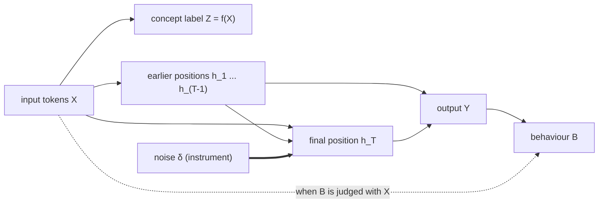

# Causal probes via instrumental variables

Activation steering changes a language model's behaviour by adding a vector to its
hidden activations at inference time. Methods for finding steering vectors broadly fall
into two types.

1. **Observational methods** model the relationship between a concept of the input,
   Z = f(X), and the activations H. Examples are the difference of class means
   E[H | Z = 1] − E[H | Z = 0] and linear probes that predict Z from H (Turner et al.,
   2023; Rimsky et al., 2024; Li et al., 2023).
2. **Interventional methods** model the effect of the activations H on the model's
   behaviour B. They learn an intervention on H by backpropagating through the model, so
   that the behaviour under the intervention matches a target. Examples are distributed
   alignment search (DAS; Geiger et al., 2024; Wu et al., 2023) and its steering variant
   CDAS (Bao et al., 2026), representation finetuning (Wu et al., 2024), and steering
   vectors trained by preference optimisation (Cao et al., 2024).

Both have limitations:

- *Observational methods* are simple, needing only forward passes and a regression, but
  a direction that detects a concept well need not steer the model well. On AxBench (Wu
  et al., 2025), linear probes rank second of twelve methods at concept detection but
  eleventh at steering, and Li et al. (2023) and Marks and Tegmark (2024) also find that
  probe weight vectors steer less well than mean differences.
- *Interventional methods* target the effect of H on B directly, but add complexity:
  gradient-based optimisation through the model with its own hyperparameters, and often
  paired counterfactual prompts or example outputs. Non-differentiable behaviour, such
  as a judge score or a binary outcome, also requires policy gradients and sampled
  rollouts (Sinii et al., 2025; Poupart et al., 2026).

Our aim is to target the effect of H on B while keeping as much of the simplicity of
the observational setting as possible.

## A simple identification strategy via instrumental variables

We conjecture that probes steer poorly mainly because they do not identify the effect of
H on B, for three reasons. First, they are usually fit to a concept of the input (such
as the correct answer) rather than to the model's behaviour (the answer it actually
gives). Second, even a probe fit to behaviour is estimated from observational data, and
so is confounded by the input and by activations at earlier positions. Third, the
activations barely vary in many of the directions the model responds to, so
observational data say little about the effect in those directions (a failure of
overlap).

Motivated by this, we propose identifying the effect of H on B with an instrumental
variable. We add Gaussian noise to the activations and use the noise as the instrument.
The noise is independent of the input by construction and moves the activations in
every direction, which addresses both confounding and lack of overlap, and two-stage
least squares (2SLS) reduces to regressing behaviour on the noise. Like a probe, this
only needs samples of behaviour and a linear regression, with no gradients or
optimisation, and it applies to any measure of behaviour, including binary outcomes. In
initial experiments on one task in Pythia-70m (Biderman et al., 2023), the resulting
direction flips the model's answer about five times as often as a probe fit to the same
binary label, at matched side effects.

The estimator itself is not new: by Stein's lemma (Stein, 1981), regressing an output on
Gaussian perturbations estimates the Gaussian-smoothed gradient, as in zeroth-order and
evolution-strategy methods (Nesterov and Spokoiny, 2017; Salimans et al., 2017). What
the IV view adds is an explanation of why it identifies the effect of H on B while a
probe does not, and a common framework for noise and natural instruments such as the
final token, which we find to be valid but too weak (result 5). When B is
differentiable, the average gradient can be computed directly by backpropagation, which
is cheaper, so the method is aimed at settings where it cannot. Our experiments use a
differentiable B so that the gradient is available as a reference.

## Concept, behaviour and confounding

### Test case

We use subject-verb agreement across an object relative clause (Linzen et al., 2016;
Marvin and Linzen, 2018), with prompts such as "The author that the guards like"
followed by the next token. We define

- **Z**: the number of the subject, read off the template (the correct answer);
- **B**: logit(" are") − logit(" is") at the final position, so that sign(B) is the
  model's answer.

Z and B measure the same thing, one from the input and one from the output. They
disagree on attraction errors ("The author that the guards *are*"), which make up about
6% of items for Pythia-70m.

### Concept versus behaviour

A direction fit to Z shows where the input's concept is encoded. Since the activations
have no causal effect on Z, this direction does not estimate a causal effect, and it
steers well only to the extent that where the concept is encoded coincides with what
later layers read. Our hypothesis is that mapping input concepts to activations can only
take us so far, and that steering directions should be fit to behaviour. Interventional
methods such as DAS also use the concept, but only to define a target behaviour, so they
still estimate an effect of H on B.

### Causal graph

For the residual stream at layer ℓ, let h_T be the activation at the final position,
where the next token is predicted.



Steering acts on h_T, so the target is the effect h_T → Y → B. A probe instead estimates
the association between h_T and its label, which also includes backdoor paths:

| Probe label | Backdoor path | Consequence |
|---|---|---|
| concept Z | h_T ← X → Z | h_T has no causal effect on Z, so the probe is purely associational |
| behaviour B | h_T ← X → h_(<T) → Y → B | later layers also read the earlier positions |
| judged behaviour b(X, Y) | h_T ← X → B | the judge also sees the input (as in AxBench) |

At the last layer, Y depends only on h_T and the second path is absent.

### A bilinear model of behaviour

Write h = (h_T, h_(<T)) for the activations at layer ℓ, and suppose behaviour is
bilinear in the activations and a vector of context features c(X),

$$B = c(X)^\top A h + \varepsilon = c(X)^\top A_T h_T + c(X)^\top A_{\lt T} h_{\lt T} + \varepsilon.$$

This is the simplest model in which the context interacts with the activations. It is
more realistic for a transformer than an additive model, since attention makes the way
later layers read h_T depend on the earlier positions. Unless B is judged with X, the
input affects B only through h, so c(X) can be read as the context that later layers
compute from the earlier positions. The effect of h_T on B then varies with the input,
β(X) = A_Tᵀc(X), and a single steering vector targets the average effect

$$\bar\beta = \mathbb{E}[\beta(X)] = \mathbb{E}[\partial B/\partial h_T],$$

which is the average gradient we use as a reference. A probe regressing B on h_T
estimates

$$\hat\beta_{\text{probe}} = \bar\beta + \Sigma_T^{-1}\mathrm{Cov}\big(h_T,\ (\beta(X) - \bar\beta)^\top h_T + c(X)^\top A_{\lt T} h_{\lt T}\big).$$

The second term is the confounding bias. Its first part comes from effect heterogeneity:
the effect of h_T varies with the input, and since both depend on X, this variation is
correlated with h_T (the correlated random coefficient model in econometrics; Heckman
and Vytlacil, 1998). Its second part is the path through earlier positions. Along an
eigendirection of Σ_T with variance λ, the bias can be as large as √(Var(U)/λ), where U
is the second argument of the covariance, so it is largest where h_T barely varies
across inputs. Regularisation instead shrinks these directions towards zero, so either
way the probe cannot recover β̄ where the data do not vary.

An instrument removes this bias if it is independent of the confounders (exogeneity)
and moves h_T in every direction (rank). Noise δ ~ N(0, s²I) added to h_T satisfies
both by construction. The first stage of 2SLS is then the identity, so

$$\hat\beta_{\text{IV}} = \Sigma_\delta^{-1}\mathrm{Cov}(\delta, B) = \Sigma_\delta^{-1}\mathbb{E}\big[\delta\delta^\top\beta(X)\big] = \bar\beta,$$

where B is measured with the noise added. Since δ is also independent of the
coefficients β(X), 2SLS recovers their average (cf. Wooldridge, 1997). Outside this
model, by Stein's lemma the same regression estimates the gradient of B averaged over the
noise and the inputs, so s trades off locality against signal. If only the binary answer
1[B > 0] is observed, the regression is a linear probability model, and only
perturbations that flip the answer carry information.

## Initial results

### Evaluation

Train and test items use disjoint subject nouns. Each direction pushes held-out items
towards the opposite of their current answer at a fixed norm (α times the mean ‖h_T‖),
and we record how often the answer flips and the off-target KL divergence of the
next-token distribution (excluding " is" and " are"). The reference is the average
gradient E[∂B/∂h_T], computed by backpropagation. Results use a single train/test split
(6,384 training and 1,616 held-out items) and a single noise seed; binomial standard
errors on the flip rates are at most about 1.3 percentage points. All directions are
evaluated on the is/are readout that the behaviour directions are fit to, which favours
them; whether they transfer to other readouts of the same concept (e.g. was/were) is
still to be tested.

### Results

**1. The activations encode the concept beyond what the model acts on.** On the items
where Pythia-70m gives the wrong verb, a probe on h_T at layer 4 still recovers the
correct Z 97.6% of the time (124 errors). At layer 3, the probe on Z predicts Z almost
perfectly (held-out log-loss 0.002), yet steers no better than a random direction (flip
rate 2.5% at α = 0.4, against 1.8%).

**2. Observational directions do not recover the causal direction, whether fit to the
concept or to behaviour.** Layer 4, cosine with the average gradient and steering on
items the model gets right:

| Direction | Label | cos with gradient | flips at α=0.2 | flips at α=0.4 |
|---|---|---|---|---|
| average gradient | | 1.00 | 0.83 | 1.00 |
| probe | concept Z | 0.11 | 0.02 | 0.12 |
| mean difference | concept Z | 0.19 | 0.06 | 0.28 |
| probe | behaviour sign(B) | 0.10 | 0.02 | 0.11 |
| probe | behaviour B | 0.12 | 0.02 | 0.11 |
| mean difference | behaviour sign(B) | 0.20 | 0.05 | 0.26 |
| random | | −0.02 | 0.01 | 0.04 |

Fitting the probe to the model's own answer instead of the correct answer makes little
difference, which is consistent with the behaviour probe also being confounded.

**3. Consistent with confounding through earlier positions.** The probe on B agrees with
the gradient at the last layer, where the path through earlier positions is absent, but
not at earlier layers:

| layer | 1 | 2 | 3 | 4 | 5 | 6 (last) |
|---|---|---|---|---|---|---|
| cos(probe on B, gradient) | 0.06 | 0.09 | 0.04 | 0.12 | 0.33 | 0.86 |

At the last layer B is also close to linear in h_T, so this does not on its own separate
confounding from nonlinearity. A probe on all positions at layer ℓ, which removes the
path through earlier positions, would separate the two.

**4. The model is sensitive in directions where the activations barely vary.** Share of
the gradient's squared norm inside the subspace holding 90% of the variance of h_T:

| layer | 1 | 2 | 3 | 4 | 5 | 6 |
|---|---|---|---|---|---|---|
| gradient | 0.04 | 0.04 | 0.05 | 0.08 | 0.21 | 0.55 |
| random direction | 0.04 | 0.04 | 0.07 | 0.07 | 0.08 | 0.10 |

At layers 1–4 the gradient overlaps with this subspace no more than a random direction
does, so observational data contain little information about the effect of h_T in the
directions that matter.

**5. A valid instrument must also move h_T in the relevant directions.** The final token
(the verb inside the relative clause) is a valid instrument by causal masking: earlier
positions cannot attend to it, so it affects B only through h_T. However, it moves h_T
in only 32 directions, which contain about 5% of the gradient's squared norm. The
resulting 2SLS direction has cosine ≈ 0 with the gradient and steers like a random
direction.

**6. Noise IV recovers the causal direction, including from a binary outcome.** Layer 4:

| Direction | answers flipped by the noise | cos with gradient | flips at α=0.2 | flips at α=0.4 |
|---|---|---|---|---|
| noise IV, continuous B, s=0.4 | 9% | 0.95 | 0.83 | 1.00 |
| noise IV, binary answer, s=1 | 31% | 0.60 | 0.53 | 1.00 |
| noise IV, binary answer, s=0.4 | 9% | 0.64 | 0.43 | 0.995 |
| noise IV, binary answer, s=0.1 | 2% | 0.27 | 0.08 | 0.34 |
| probe on sign(B), same label | | 0.10 | 0.02 | 0.11 |

At matched off-target KL (≈ 0.3), the binary noise IV flips 53% of answers, compared with
26% for the best mean difference and 11% for the probe on sign(B). Layers 3 and 5 show
the same pattern. With a binary outcome, the noise needs to be large enough to flip a
reasonable share of answers (here 10–30%).

## Next steps

1. Extend to non-differentiable behaviours such as indicators and judge scores, and
   compare with probes fit to the same labels and with policy-gradient steering (Poupart
   et al., 2026).
2. Implement on larger models (e.g. AxBench replications), and check how many
   perturbations are needed as d grows.
3. Is Gaussian noise the right instrument? Isotropic noise pushes the activations off
   their natural distribution. Any noise independent of the input is still valid, so
   could try noise that stays closer to it (e.g. norm-preserving, or resampled from other
   inputs' activations), while keeping enough variation in the directions the model is
   sensitive to.

## Scripts

| Script | Does |
|---|---|
| `stimuli.py` | builds the prompts (`pp`, `orc`, `orc_pp` frames) |
| `pilot.py` | error rates per model/frame, and whether h_T still encodes Z on the model's errors |
| `lm.py` | residual capture, B, gradient, steering and cached perturbation passes |
| `compare.py` | observational directions (probes, mean differences) and the gradient; geometry and steering |
| `iv.py` | verb-instrumented 2SLS and its diagnostics |
| `steer_iv.py` | verb IV and noise IV (continuous and binary), steering compared with `compare.py` |

## Running

```
python -m venv .venv
.venv\Scripts\python -m pip install -r requirements.txt

# pilot
.venv\Scripts\python stimuli.py
.venv\Scripts\python pilot.py

# main comparison (Pythia-70m, relative-clause frame, 8000 prompts)
.venv\Scripts\python stimuli.py --frames orc --n-per-cell 2000 --out results/compare/stimuli.csv
.venv\Scripts\python compare.py
.venv\Scripts\python iv.py
.venv\Scripts\python steer_iv.py
```

Everything runs on a laptop CPU. `compare.py` takes about 40 minutes and `steer_iv.py`
about 20.

`results/compare/steering_cont.csv` comes from an earlier version of `steer_iv.py`
(continuous noise IV with s in {0.01, 0.1, 0.4} and 2 draws per item);
`steering_binary.csv` is from the current version. In `results/compare/geometry.csv`
the `test_acc_*` columns hold negative held-out log-loss rather than accuracy (fixed in
the code since that run).

## References

- Bao, Y., Zhang, X., Chen, J., et al. (2026). Faithful bi-directional model steering via
  distribution matching and distributed interchange interventions. *ICLR*.
  [arXiv:2602.05234](https://arxiv.org/abs/2602.05234)
- Biderman, S., et al. (2023). Pythia: A suite for analyzing large language models across
  training and scaling. *ICML*. [arXiv:2304.01373](https://arxiv.org/abs/2304.01373)
- Cao, Y., et al. (2024). Personalized steering of large language models: Versatile
  steering vectors through bi-directional preference optimization. *NeurIPS*.
  [arXiv:2406.00045](https://arxiv.org/abs/2406.00045)
- Geiger, A., Wu, Z., Potts, C., Icard, T. and Goodman, N. (2024). Finding alignments
  between interpretable causal variables and distributed neural representations.
  *CLeaR*. [arXiv:2303.02536](https://arxiv.org/abs/2303.02536)
- Heckman, J. J. and Vytlacil, E. (1998). Instrumental variables methods for the
  correlated random coefficient model: Estimating the average rate of return to
  schooling when the return is correlated with schooling. *Journal of Human Resources*,
  33(4), 974–987.
- Li, K., Patel, O., Viégas, F., Pfister, H. and Wattenberg, M. (2023). Inference-time
  intervention: Eliciting truthful answers from a language model. *NeurIPS*.
  [arXiv:2306.03341](https://arxiv.org/abs/2306.03341)
- Linzen, T., Dupoux, E. and Goldberg, Y. (2016). Assessing the ability of LSTMs to learn
  syntax-sensitive dependencies. *TACL*. [arXiv:1611.01368](https://arxiv.org/abs/1611.01368)
- Marks, S. and Tegmark, M. (2024). The geometry of truth: Emergent linear structure in
  large language model representations of true/false datasets. *COLM*.
  [arXiv:2310.06824](https://arxiv.org/abs/2310.06824)
- Marvin, R. and Linzen, T. (2018). Targeted syntactic evaluation of language models.
  *EMNLP*. [arXiv:1808.09031](https://arxiv.org/abs/1808.09031)
- Nesterov, Y. and Spokoiny, V. (2017). Random gradient-free minimization of convex
  functions. *Foundations of Computational Mathematics*, 17, 527–566.
- Poupart, Y., Beynier, A. and Maudet, N. (2026). Policy gradient steering: Interventions
  from behavioral objectives. [arXiv:2607.27574](https://arxiv.org/abs/2607.27574)
- Rimsky, N., Gabrieli, N., Schulz, J., Tong, M., Hubinger, E. and Turner, A. M. (2024).
  Steering Llama 2 via contrastive activation addition. *ACL*.
  [arXiv:2312.06681](https://arxiv.org/abs/2312.06681)
- Salimans, T., Ho, J., Chen, X., Sidor, S. and Sutskever, I. (2017). Evolution
  strategies as a scalable alternative to reinforcement learning.
  [arXiv:1703.03864](https://arxiv.org/abs/1703.03864)
- Sinii, V., Balagansky, N., Gerasimov, G., et al. (2025). Small vectors, big effects: A
  mechanistic study of RL-induced reasoning via steering vectors.
  [arXiv:2509.06608](https://arxiv.org/abs/2509.06608)
- Stein, C. M. (1981). Estimation of the mean of a multivariate normal distribution.
  *Annals of Statistics*, 9(6), 1135–1151.
- Turner, A. M., Thiergart, L., Leech, G., Udell, D., Vazquez, J. J., Mini, U. and
  MacDiarmid, M. (2023). Steering language models with activation engineering.
  [arXiv:2308.10248](https://arxiv.org/abs/2308.10248)
- Wooldridge, J. M. (1997). On two stage least squares estimation of the average
  treatment effect in a random coefficient model. *Economics Letters*, 56(2), 129–133.
- Wu, Z., Arora, A., Geiger, A., Wang, Z., Huang, J., Jurafsky, D., Manning, C. D. and
  Potts, C. (2025). AxBench: Steering LLMs? Even simple baselines outperform sparse
  autoencoders. *ICML*. [arXiv:2501.17148](https://arxiv.org/abs/2501.17148)
- Wu, Z., Arora, A., Wang, Z., Geiger, A., Jurafsky, D., Manning, C. D. and Potts, C.
  (2024). ReFT: Representation finetuning for language models. *NeurIPS*.
  [arXiv:2404.03592](https://arxiv.org/abs/2404.03592)
- Wu, Z., Geiger, A., Icard, T., Potts, C. and Goodman, N. (2023). Interpretability at
  scale: Identifying causal mechanisms in Alpaca. *NeurIPS*.
  [arXiv:2305.08809](https://arxiv.org/abs/2305.08809)
