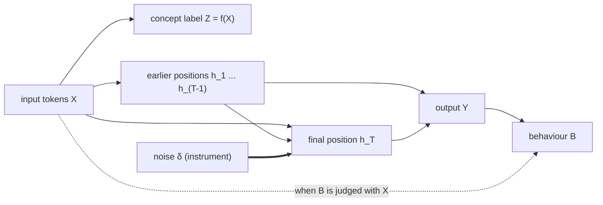

# Steering directions from behaviour, not concepts: probes and confounding

There are two ways to find a direction in a model's activations to steer with.

- **Concept-led**: map an *input* concept Z = f(X) onto the activations, by a mean
  difference E[h | Z = 1] − E[h | Z = 0] or a probe that decodes Z from h. This finds
  where the input's concept is encoded.
- **Behaviour-led**: regress the model's *own behaviour* B = b(Y) on the activations.
  This finds the direction that drives what the model does.

The hypothesis here is that concept-led identification can only take us so far. h has
no causal effect on Z, which is fixed by the input, so a concept direction is not an
estimate of any causal effect; it steers well only insofar as where the concept is
written coincides with what the model reads out. Activations can encode a concept the
model then doesn't act on.

Behaviour-led probing targets the right quantity, the effect of h on behaviour, and
"should" be the way forward. But a probe is fit to **observational** activations, so it
is an observational causal estimate, and it is **confounded**. The fix is an
**instrumental variable**: Gaussian noise added to the activation is an ideal
instrument, and with it two-stage least squares reduces to regressing the behaviour on
the noise. That works even when the behaviour is only observed as a binary outcome.

There is no interventional version of the concept-led approach: perturbing h cannot
change Z. Once identification is done properly, steering directions are necessarily
behaviour-led.

## Concept and behaviour in the test case

Subject-verb agreement in Pythia-70m, with prompts like "The author that the guards
like" → next token:

- **Z**: the number of the subject, read off the template. The true answer.
- **B**: logit(" are") − logit(" is") at the final position. sign(B) is the model's
  answer to the same question.

Z and B measure the same thing, one from the input and one from the output. They
disagree on attraction errors ("The author that the guards *are*"), about 6% of items.

## The causal graph

For the residual stream at layer ℓ, with h_T at the final position (where the next
token is predicted):



Steering acts on h_T, so the target is the effect h_T → Y → B. A probe instead
estimates the association between h_T and its label, which also flows through
backdoor paths:

| Probe label | Backdoor path | Consequence |
|---|---|---|
| concept Z (concept-led) | h_T ← X → Z | h_T has **no** causal effect on Z; the probe is pure association |
| behaviour B (behaviour-led) | h_T ← X → h_(<T) → Y → B | later layers also read the earlier positions |
| judged behaviour b(X, Y) | h_T ← X → B | the judge sees the input (as in AxBench) |

At the last layer, Y depends on h_T alone and the second path disappears.

## Linear model

Suppose B = βᵀh_T + γᵀh_(<T) + c(X) + ε. A probe regressing B on h_T estimates

$$\hat\beta_{\text{probe}} = \beta + \Sigma_T^{-1}\,\mathrm{Cov}\big(h_T,\ \gamma^\top h_{<T} + c(X)\big).$$

The second term is confounding bias. Along an eigendirection of Σ_T with variance λ it
can be as large as √(Var(confounder)/λ), so it is worst where h_T barely varies across
inputs; with regularisation, those directions are shrunk to zero instead. Either way,
the probe can't recover β where the data doesn't move.

An instrument fixes this if it is independent of the confounders (exogeneity) and
moves h_T in every direction (rank). Add noise δ ~ N(0, s²I) to h_T. δ is independent
of X, h_(<T) and ε by construction, it is full-rank, and the first stage of 2SLS is the
identity, so

$$\hat\beta_{\text{IV}} = \Sigma_\delta^{-1}\,\mathrm{Cov}(\delta, B) = \beta.$$

Beyond the linear model, by Stein's lemma the same regression estimates the gradient of
B averaged over the noise, so s trades locality against signal. If only the binary
answer 1[B > 0] is observed, the regression is a linear probability model; it carries
signal only from perturbations that flip the answer.

## Evaluation

Train and test items have disjoint subject nouns. Each direction is used to push
held-out items toward the opposite of their current answer at a fixed norm (α × the
mean ‖h_T‖); we record how often the answer flips and the off-target KL of the
next-token distribution. The reference is the mean gradient E[∂B/∂h_T] (the "oracle").

## Evidence

**1. Activations encode the concept beyond what the model acts on.** On the items where
Pythia-70m gives the wrong verb, a probe on h_T at layer 4 still recovers the true Z
97.6% of the time (124 errors). And at layer 3 the probe on Z decodes Z almost
perfectly (held-out log-loss 0.002) yet steers no better than a random direction
(flips at α=0.4: 2.5% vs 1.8%). Decodable is not causal.

**2. Observational directions miss the causal direction, concept-led or
behaviour-led.** Layer 4, cosine with the gradient and steering on items the model gets
right:

| Direction | Label | cos with gradient | flips at α=0.2 | flips at α=0.4 |
|---|---|---|---|---|
| gradient (oracle) | | 1.00 | 0.83 | 1.00 |
| probe | concept Z | 0.11 | 0.02 | 0.12 |
| mean difference | concept Z | 0.19 | 0.06 | 0.28 |
| probe | behaviour sign(B) | 0.10 | 0.02 | 0.11 |
| probe | behaviour B | 0.12 | 0.02 | 0.11 |
| mean difference | behaviour sign(B) | 0.20 | 0.05 | 0.26 |
| random | | −0.02 | 0.01 | 0.04 |

Switching the label from the concept to the model's own answer changes little on its
own: fit observationally, the behaviour-led probe is confounded too.

**3. Confounding through earlier positions.** The behaviour-led probe agrees with the
gradient at the last layer, where that path is absent, and not before:

| layer | 1 | 2 | 3 | 4 | 5 | 6 (last) |
|---|---|---|---|---|---|---|
| cos(probe on B, gradient) | 0.06 | 0.09 | 0.04 | 0.12 | 0.33 | 0.86 |

**4. The model is sensitive where activations don't vary.** Share of the gradient's
squared norm inside the subspace holding 90% of h_T's variance:

| layer | 1 | 2 | 3 | 4 | 5 | 6 |
|---|---|---|---|---|---|---|
| gradient | 0.04 | 0.04 | 0.05 | 0.08 | 0.21 | 0.55 |
| random direction | 0.04 | 0.04 | 0.07 | 0.07 | 0.08 | 0.10 |

**5. An exogenous instrument isn't enough; it must also be full-rank.** The final token
(the embedded verb) is a valid instrument by causal masking: earlier positions can't
attend to it, so it reaches B only through h_T. But it moves h_T in only 32 directions,
which contain about 5% of the gradient. The resulting 2SLS direction has cosine ≈ 0
with the gradient and steers like a random direction.

**6. With a noise instrument, behaviour-led probing works, including from a binary
outcome.** Layer 4:

| Direction | answers flipped by the noise | cos with gradient | flips at α=0.2 | flips at α=0.4 |
|---|---|---|---|---|
| noise IV, continuous B, s=0.4 | 9% | 0.95 | 0.83 | 1.00 |
| noise IV, binary answer, s=1 | 31% | 0.60 | 0.53 | 1.00 |
| noise IV, binary answer, s=0.4 | 9% | 0.64 | 0.43 | 0.995 |
| noise IV, binary answer, s=0.1 | 2% | 0.27 | 0.08 | 0.34 |
| probe on sign(B), same label | | 0.10 | 0.02 | 0.11 |

At equal off-target KL (≈0.3) the binary noise IV flips 53% of answers, against 26% for
the best mean difference and 11% for the probe on sign(B). Layers 3 and 5 show the
same pattern.

## Not yet shown

- **Transfer.** Every direction is evaluated on the is/are readout that the
  behaviour-led ones are fit to, which favours them. If concept-led directions transfer
  better to other readouts of the same concept (was/were, has/have, generated text),
  that limits the hypothesis. This is the most important open test.
- **How much of the probe's failure is confounding by earlier positions, and how much
  is lack of variation.** A probe on all positions at layer ℓ removes the
  earlier-position path; if it still fails, the remaining problem is variation.
- **Noise restricted to the data's principal subspace** (exogenous but not full-rank):
  predicted to fail like the verb instrument.
- **Scale**: larger models, semantic concepts, judge-scored behaviour. The regression
  has d unknowns, so the number of perturbations grows with model width.

## Scripts

| Script | Does |
|---|---|
| `stimuli.py` | builds the prompts (`pp`, `orc`, `orc_pp` frames) |
| `pilot.py` | error rates per model/frame, and whether h_T still encodes Z on the model's errors |
| `lm.py` | residual capture, B, gradient, steering and cached perturbation passes |
| `compare.py` | observational directions (probes, mean differences) and the gradient; geometry and steering |
| `iv.py` | verb-instrumented 2SLS and its diagnostics |
| `steer_iv.py` | verb IV and noise IV (continuous and binary), steering compared with `compare.py` |

## Running

```
python -m venv .venv
.venv\Scripts\python -m pip install -r requirements.txt

# pilot
.venv\Scripts\python stimuli.py
.venv\Scripts\python pilot.py

# main comparison (Pythia-70m, relative-clause frame, 8000 prompts)
.venv\Scripts\python stimuli.py --frames orc --n-per-cell 2000 --out results/compare/stimuli.csv
.venv\Scripts\python compare.py
.venv\Scripts\python iv.py
.venv\Scripts\python steer_iv.py
```

Everything runs on a laptop CPU. `compare.py` takes about 40 minutes; `steer_iv.py`
about 20.

`results/compare/steering_cont.csv` comes from an earlier version of `steer_iv.py`
(continuous noise IV with s in {0.01, 0.1, 0.4} and 2 draws per item);
`steering_binary.csv` is from the current version. In `results/compare/geometry.csv`
the `test_acc_*` columns hold negative held-out log-loss, not accuracy (fixed in the
code since that run).
